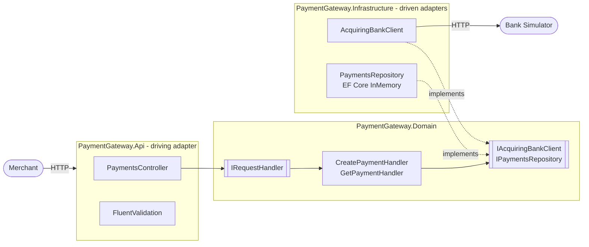

# Payment Gateway

An ASP.NET Core (.NET 8) API that lets a merchant process card payments through an acquiring bank and retrieve previously made payments. Built for the Checkout.com engineering challenge.

## Features

- **Process a payment**: validates the request, stores it as `Pending`, sends it to the acquiring bank (simulator) and returns `Authorized` or `Declined`
- **Retrieve a payment**: returns a stored payment by ID
- **Validation**: invalid requests are rejected with all errors at once; the bank is never called
- **Card data safety**: only the last 4 card digits are stored or returned; CVV is never stored or logged
- **Observability**: correlation ID on every request and log line, JSON structured logs, request logging, health check
- **Containerised**: Alpine-based Docker image running as a non-root user

## Endpoints

| Method | Route | Description |
|---|---|---|
| `POST` | `/api/v1/payments` | Process a payment |
| `GET` | `/api/v1/payments/{id}` | Retrieve a payment |
| `GET` | `/health` | Health check |
| `GET` | `/swagger` | API documentation |

### Responses

| Case | HTTP | Body |
|---|---|---|
| Bank authorized | `201 Created` | Payment, `status: Authorized`, `Location` header |
| Bank declined | `201 Created` | Payment, `status: Declined` |
| Invalid request (Rejected) | `400 Bad Request` | `ValidationProblemDetails` with all field errors |
| Payment not found | `404 Not Found` | `ProblemDetails` |
| Bank unavailable (non-2xx, unreachable, timeout, invalid reply) | `502 Bad Gateway` | `ProblemDetails`; payment stored as `Failed` |
| Unexpected error | `500 Internal Server Error` | `ProblemDetails` |

### Example

```bash
curl -X POST http://localhost:5000/api/v1/payments \
  -H "Content-Type: application/json" \
  -H "X-Correlation-ID: my-request-1" \
  -d '{"card_number":"2222405343248877","expiry_month":4,"expiry_year":2027,"currency":"GBP","amount":100,"cvv":"123"}'
```

```json
{
  "id": "fad0ca48-3f9b-4035-b86c-b5f5f24bc3c8",
  "status": "Authorized",
  "card_number_last_four": "8877",
  "expiry_month": 4,
  "expiry_year": 2027,
  "currency": "GBP",
  "amount": 100
}
```

```bash
curl http://localhost:5000/api/v1/payments/fad0ca48-3f9b-4035-b86c-b5f5f24bc3c8
```

Rejected request:

```json
{
  "type": "https://tools.ietf.org/html/rfc9110#section-15.5.1",
  "title": "One or more validation errors occurred.",
  "status": 400,
  "errors": {
    "card_number": ["Card number must be 14-19 digits."],
    "cvv": ["CVV must be 3-4 digits."]
  },
  "trace_id": "00-f3a6c09b4345d61e7b8a3d773e0a6019-56467a1cc3ea6671-00"
}
```

### Bank simulator test cards

| Card number | Last digit | Result |
|---|---|---|
| `2222405343248877` | Odd | `201 Authorized` |
| `2222405343248112` | Even | `201 Declined` |
| `2222405343248870` | `0` | `502 Bad Gateway` (bank returns 503) |

## System Design

### Architecture

Hexagonal (ports and adapters), following the Clean Architecture dependency rule: dependencies point inwards and the Domain references no other project.



| Project | Responsibility |
|---|---|
| `PaymentGateway.Api` | HTTP: routing, validation, mapping API models, problem details, middleware |
| `PaymentGateway.Domain` | Business logic: handlers (use cases), `Payment` model, ports |
| `PaymentGateway.Infrastructure` | Bank HTTP client, EF Core repository, DI registration |

### Payment flow

1. Controller validates the request; invalid requests return `400` and the bank is never called
2. `Payment.Create(...)` builds a `Pending` payment (last 4 digits only, no CVV) and saves it before the bank is called
3. `CreatePaymentHandler` calls the bank through `IAcquiringBankClient`
4. Bank unavailable: the payment is updated to `Failed`, `BankUnavailableError` mapped to `502`
5. Bank responded: `payment.Complete(...)` sets `Authorized` or `Declined`, the payment is updated, `201` returned

### Design decisions

- **Ports and adapters**: Domain owns the interfaces; Infrastructure implements them. The in-memory store or the bank client can be swapped without touching business logic
- **Use cases in Domain**: no separate Application project, as the scope is small
- **Result types instead of exceptions**: [OneOf](https://github.com/mcintyre321/OneOf) results (`Success`, `NotFound`, `BankUnavailableError`, `InternalError`) make every outcome explicit and map cleanly to HTTP codes
- **Factory and state methods**: `Payment.Create(...)` (Pending, card masking), `Complete(...)` and `Fail()` own the status rules
- **`TimeProvider`**: injected for expiry validation and timestamps, so tests control time
- **Separate models per layer**: API request/response, Domain models, bank JSON models and database entities are mapped only at layer boundaries
- **snake_case JSON**: request, response and error fields (`card_number`, `trace_id`) follow the Checkout.com public API convention; one serializer policy plus a ProblemDetails customization keeps it consistent
- **Bank client**: typed `HttpClient`, snake_case via `JsonNamingPolicy.SnakeCaseLower`, configurable timeout. Non-success responses, network errors, timeouts and invalid replies all become `BankUnavailableError`
- **Pending before the bank call**: every attempt is recorded, and a crash or failed update mid-flow leaves `Pending` rather than losing a possibly charged payment. Bank failures end as `Failed` (502)
- **Update after the bank call is not cancellable**: the card may already be charged, so the update uses `CancellationToken.None`
- **No retries**: retrying a payment without an idempotency key risks charging the customer twice
- **Cancellation**: `CancellationToken` is passed end to end; client cancellations are never reported as errors

## Prerequisites

- [.NET SDK 8.0](https://dotnet.microsoft.com/download/dotnet/8.0)
- [Docker Desktop](https://www.docker.com/products/docker-desktop/)

## Usage

### Run in Docker (API + bank simulator)

```bash
docker compose up -d --build
```

- API: http://localhost:5000
- Swagger: http://localhost:5000/swagger
- Logs: `docker logs -f payment_gateway`
- Stop: `docker compose down`

### Run locally

```bash
docker compose up -d bank_simulator
dotnet run --project src/PaymentGateway.Api
```

- Swagger: https://localhost:7092/swagger (or http://localhost:5067/swagger)

### Configuration

| Setting | Default | Description |
|---|---|---|
| `AcquiringBank:BaseUrl` | `http://localhost:8080/` | Bank simulator URL |
| `AcquiringBank:Timeout` | `00:00:10` | Bank request timeout |
| `Swagger:Enabled` | `false` | Enables Swagger outside Development |

Override with environment variables, e.g. `AcquiringBank__BaseUrl=http://bank_simulator:8080/`.

## Testing

```bash
docker compose up -d bank_simulator
dotnet test
```

| Project | Tests | Scope |
|---|---|---|
| `PaymentGateway.Tests.Unit` | 69 | Validator, mappers, handlers, `Payment`, bank client (mocked `HttpMessageHandler`), repository, correlation ID middleware |
| `PaymentGateway.Tests.Integration` | 11 | Full API via `WebApplicationFactory` against the real bank simulator: Authorized, Declined, bank 503, bank unreachable, bank timeout, validation, malformed JSON, GET, 404, health |

Tools: xUnit, Moq, AutoFixture, FluentValidation `TestHelper`.

- Integration tests require the bank simulator running
- Expiry dates are generated relative to today, so tests do not go stale

## Observability

- **Correlation ID**: `X-Correlation-ID` is read from the request (or generated from the trace ID), returned in the response and attached to every log line. Incoming values are validated to prevent log injection
- **Structured logs**: JSON console logs with scopes and UTC timestamps (outside Development); message templates such as `Payment {PaymentId} processed with status {PaymentStatus}`
- **Request logging**: method, path, status code and duration only; bodies and headers are never logged
- **Errors**: RFC 9110 `ProblemDetails` with `trace_id`
- **Health check**: `GET /health`

## Assumptions

- A card expiring in the current month is still valid (cards are valid until the end of the expiry month)
- Supported currencies are `GBP`, `USD` and `EUR`; input is case-insensitive and normalised to upper case (e.g. `gbp` is stored and returned as `GBP`)
- Amount must be greater than zero
- Rejected payments are not stored, as no payment is created
- Any bank failure (non-2xx, network error, timeout, invalid reply) is reported as `502 Bad Gateway` and the payment is stored as `Failed`. A timeout may still have been authorized by the bank; reconciliation would resolve it
- A payment is only `Pending` during the bank call, or after a crash or failed update; it stays `Pending` until reconciliation is added
- In-memory storage is acceptable; data is lost on restart

## Productionise the ApplicationF

- **Idempotency**: `Idempotency-Key` header on POST, following the IETF draft. Same key and body replays the stored response (Authorized or Declined) without calling the bank; same key with a different body returns `422`; same key while the original is still in progress returns `409`. Keys reserved atomically and stored in Redis or the database for ~24h, scoped per merchant. This makes retries to the bank safe
- **Reconciliation**: a background job resolves `Pending` payments, and `Failed` ones caused by a timeout, with the bank (status lookup) and moves them to `Authorized` or `Declined`
- **Persistence**: replace EF Core InMemory with Postgres or SQL Server via `IPaymentsRepository`
- **Security**: merchant authentication (OAuth2 / API keys), scope `GET` to the owning merchant, rate limiting, HTTPS only, Payment Card Industry Data Security Standard (PCI DSS) scope reduction via card tokenisation
- **Resilience**: circuit breaker on bank calls; retries only with idempotency
- **Observability**: OpenTelemetry traces and metrics (e.g. payments by status, bank latency) exported to Prometheus/Grafana or Datadog; alerting on bank error rate
- **Deployment**: CI/CD pipeline (build, test, image scan, deploy), Kubernetes with liveness/readiness probes, chiseled runtime image, secrets in a vault

## Future Improvements

- Full payment lifecycle: capture, void, refund (status as a state machine)
- More currencies, with per-currency amount rules (minor units)
- Card number Luhn check
- Contract tests against the bank API
- Load tests to establish latency and throughput baselines
